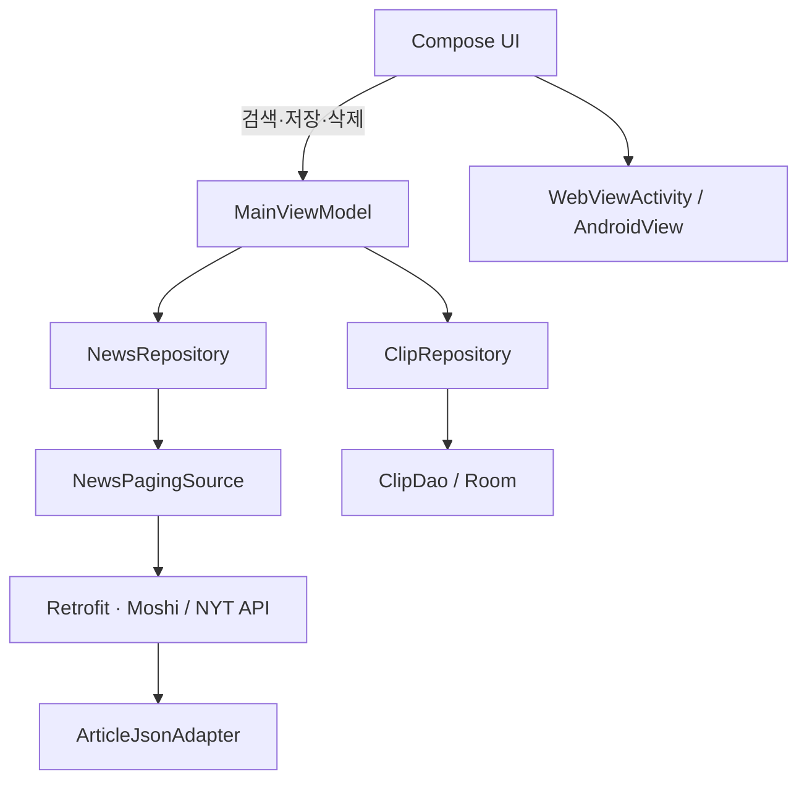

# Newsclip

NYT 기사를 검색하고 관심 있는 기사를 클립으로 저장하는 Android 과제 앱입니다.

**MVVM · Hilt · Jetpack Compose · Paging 3 · Room**을 사용하며, XML 기반으로 작성했던 화면을 Compose로 전환했습니다.

## 과제 목적과 범위

기사 검색부터 로컬 저장까지 하나의 사용자 흐름을 구현하면서, 화면과 데이터 접근의 역할 분리 및 Android 주요 라이브러리의 활용을 보여주는 것을 목표로 했습니다.

2023년 작성한 XML 기반 앱을 바탕으로 페이징과 데이터 식별 문제를 보완하고, Compose 전환과 회귀 테스트를 추가했습니다. 실서비스 운영보다는 핵심 기능, 상태 관리, 구현 선택을 설명할 수 있는 작은 코드베이스에 집중했습니다.

예외 처리는 네트워크·인증·요청 제한 안내와 재시도를 중심으로 간결하게 구성했습니다. 운영용 상세 로깅, 저장 실패 복구, 서비스 배포 구성은 과제 범위에서 제외했습니다.

## 주요 기능

| 기능 | 동작 |
| --- | --- |
| 기사 검색 | 검색어 입력 후 키보드 검색 버튼으로 NYT 기사 조회 |
| 페이징 | 스크롤에 따라 다음 페이지 요청, 마지막 페이지에서 종료 |
| 새로고침·재시도 | 아래로 당겨 새로고침, 요청 실패 시 원인 안내와 재시도 |
| 클립 저장 | Home 목록의 기사를 좌우로 스와이프해 Room에 저장 |
| 클립 삭제 | Clip 목록의 기사를 좌우로 스와이프해 삭제 |
| 본문 열기 | 기사 선택 시 앱 내부 WebView에서 원문 열기 |
| 화면 상태 | 탭별 스크롤 상태 관리, 화면 재생성 시 선택 탭과 입력 복원 |
| 뒤로 가기 | Clip에서는 Home으로 이동, WebView에서는 페이지 이력 탐색 |

클립으로 저장하는 데이터는 제목·URL·발행 시각·이미지 정보입니다. 기사 본문을 내려받아 오프라인으로 보관하는 기능은 포함하지 않습니다.

## 구조와 설계 선택



- **MVVM:** Compose가 화면과 사용자 입력을 담당하고, ViewModel은 검색 조건과 클립 작업을 관리합니다. Repository는 네트워크와 DB 접근을 담당합니다.
- **Hilt:** ViewModel과 Repository에는 생성자 주입을 사용합니다. Retrofit과 Room은 모듈에서 생성하고 앱 범위에서 공유합니다.
- **화면 상태:** 선택 탭과 검색 입력에는 `rememberSaveable`, 목록에는 `rememberLazyListState`를 사용합니다. 두 탭 사이를 이동할 때 화면을 계속 백 스택에 쌓지 않습니다.
- **기사 식별:** 발행 시각이 같은 서로 다른 기사를 구분하기 위해 URL을 Room 기본키로 사용합니다. 같은 URL을 다시 저장하면 기존 내용을 갱신합니다.
- **API 응답 변환:** `ArticleJsonAdapter`가 NYT 이미지 데이터의 과거 배열 형식과 현재 객체 형식을 앱의 이미지 목록으로 변환합니다. 외부 응답 형식의 변경이 DB 모델에 직접 영향을 주지 않도록 했습니다.
- **범위에 맞춘 구성:** 단일 앱 모듈과 두 Repository로 구성했습니다. 별도 UseCase 계층이나 멀티모듈 분리보다 작은 기능 흐름을 명확하게 유지하는 데 집중했습니다.

주요 코드:

| 위치 | 역할 |
| --- | --- |
| [MainActivity](app/src/main/java/ggack/newsclip/main/MainActivity.kt) | Hilt ViewModel을 Compose 화면에 전달 |
| [NewsclipScreen](app/src/main/java/ggack/newsclip/main/NewsclipScreen.kt) | 검색·목록·탭·스와이프·로딩 및 오류 UI |
| [MainViewModel](app/src/main/java/ggack/newsclip/main/MainViewModel.kt) | 검색 조건과 클립 작업 관리 |
| [network](app/src/main/java/ggack/newsclip/data/network) | API 요청, 페이징, 응답 변환 |
| [db](app/src/main/java/ggack/newsclip/data/db) | 클립 저장·삭제와 변경 관찰 |
| [WebViewActivity](app/src/main/java/ggack/newsclip/webview/WebViewActivity.kt) | Compose 안에서 WebView 호스팅 및 상태 저장 |

## XML에서 Compose로 전환

기존 기능과 MVVM·Hilt·Repository 구조를 유지하면서 화면 계층을 교체했습니다.

| 전환 전 | 전환 후 |
| --- | --- |
| Activity·Fragment의 XML 레이아웃과 Data Binding | `setContent`와 Composable 함수 |
| RecyclerView Adapter·ViewHolder | `LazyColumn`과 기사 Composable |
| ItemTouchHelper | `SwipeToDismiss` |
| Fragment Navigation과 정수 기반 화면 이동 이벤트 | 저장 가능한 탭 상태와 `BackHandler` |
| SearchView 리스너를 가진 ViewModel | 화면에서 `search(query)` 호출 |
| 이미지·날짜 BindingAdapter | `AsyncImage`와 날짜 표시 함수 |
| XML WebView 레이아웃 | `AndroidView`로 기존 WebView 연결 |

레이아웃 XML, Fragment, RecyclerView Adapter, ItemTouchHelper, Data Binding 코드를 제거했습니다. 시스템 테마·아이콘·백업 설정용 XML은 유지했습니다.

전환 과정에서는 코드량뿐 아니라 상태와 부수 효과의 위치도 조정했습니다. 스와이프 후 저장·삭제는 `LaunchedEffect`에서 처리하고, API·DB 상태는 Compose에서 관찰해 화면에 반영합니다. 기존 화면 테스트는 Compose의 텍스트 입력, 클릭, 스와이프와 상태 복원 테스트로 교체했습니다.

기존 Kotlin·Hilt·Room 환경을 유지하는 범위에서 Compose를 도입했습니다. 따라서 아래 버전은 최신 구성의 예시가 아니라 **이 프로젝트에서 검증한 호환 조합**이며, Paging Compose는 알파 버전을 사용합니다.

## 테스트

2026-11-07 로컬 검증 기준, `:app:testDebugUnitTest`의 **22개 테스트가 통과**했고 `:app:assembleDebug` 빌드가 성공했습니다. 22개에는 기본 산술 예제 테스트 1개가 포함됩니다.

| 테스트 | 개수 | 주요 검증 내용 |
| --- | ---: | --- |
| [NewsPagingSourceTest](app/src/test/java/ggack/newsclip/data/network/NewsPagingSourceTest.kt) | 8 | 0부터 시작하는 페이지 요청, 부분·빈 페이지 종료, 페이지 상한, 오류·취소, 키 누락, 새로고침 기준 페이지, 실제 Retrofit 쿼리 구성 |
| [ArticleJsonAdapterTest](app/src/test/java/ggack/newsclip/data/network/ArticleJsonAdapterTest.kt) | 3 | 실제 응답 기반 fixture 파싱, 과거 이미지 배열·빈 이미지 처리, UTC 날짜 표시 |
| [ClipDatabaseTest](app/src/test/java/ggack/newsclip/data/db/ClipDatabaseTest.kt) | 2 | 같은 발행 시각의 기사 보존·삭제, 동일 URL 갱신 시 중복 방지 |
| [MainViewModelTest](app/src/test/java/ggack/newsclip/main/MainViewModelTest.kt) | 3 | 검색어 공백 정리, 빈 검색어, 클립 저장 후 삭제 |
| [MainActivityTest](app/src/test/java/ggack/newsclip/main/MainActivityTest.kt) | 5 | 반복 탭 전환·뒤로 가기, 화면 재생성, 검색 제출, 스와이프 저장·삭제와 DB 변경 반영, 인증 오류 안내·재시도 |
| [ExampleUnitTest](app/src/test/java/ggack/newsclip/ExampleUnitTest.kt) | 1 | 프로젝트 기본 예제 |

Compose UI 테스트는 **Robolectric + Hilt** 환경에서 실행하며, 실제 NYT 호출 대신 테스트용 서비스를 주입합니다. 네트워크 쿼리 테스트도 응답을 대체하므로 유효한 운영 키가 필요하지 않습니다. Room 테스트는 메모리 DB를 사용합니다.

자동 테스트와 별도로 실제 NYT API의 HTTP 200 응답과 기사 10건 수신을 확인했습니다. 이 확인은 모든 서버 응답, 실기기 동작, 프로세스 종료 후 전체 상태 복원까지 보장하지는 않습니다.

## 개발 환경

| 항목 | 설정 |
| --- | --- |
| JDK / Gradle / Android Gradle Plugin | 11 / 7.4 / 7.3.1 |
| Kotlin | 1.7.20 |
| Android SDK | min 21 / compile 33 / target 32 |
| Compose UI · Material / Compiler | 1.3.1 / 1.3.2 |
| Activity Compose / Lifecycle 선언 버전 | 1.6.1 / 2.4.0 |
| Hilt / Room | 2.44.2 / 2.4.3 |
| Retrofit / Moshi Kotlin | 2.9.0 / 1.9.3 |
| Coil Compose | 2.2.2 |
| Paging Runtime / Paging Compose | 3.1.0 / 1.0.0-alpha17 |
| Robolectric / Espresso | 4.9.2 / 3.5.1 |

의존성 선언은 [app/build.gradle](app/build.gradle)에서 확인할 수 있습니다.

## 실행 방법

1. Android Studio에서 프로젝트 루트를 엽니다.
2. Gradle JDK를 **JDK 11**로 설정하고 Android SDK Platform 33을 준비합니다. 터미널에서는 `JAVA_HOME`도 JDK 11을 가리켜야 합니다.
3. [NYT 개발자 포털](https://developer.nytimes.com/)에서 Article Search API를 사용할 수 있는 키를 발급받습니다.
4. 루트의 `local.properties`에 키를 추가합니다. Android Studio가 작성한 `sdk.dir` 값은 유지합니다.

```properties
NYT_API_KEY=YOUR_API_KEY
```

키는 Gradle 프로젝트 속성 → 환경 변수 → `local.properties` 순서로 읽습니다. `local.properties`는 Git에서 제외되며 실제 키를 저장소에 커밋하지 않습니다. 키는 빌드 시 APK에 포함되므로 값을 바꾼 뒤 다시 빌드해야 합니다. 이 방식은 저장소에서 키를 분리하는 설정이며 APK 내부의 키를 비밀로 보호하는 방식은 아닙니다.

Windows PowerShell에서 테스트와 APK 빌드:

```powershell
# 실제 API를 호출하지 않는 자동 테스트
.\gradlew.bat :app:testDebugUnitTest -PNYT_API_KEY=test-key

# local.properties 또는 환경 변수의 실제 키를 사용하는 APK
.\gradlew.bat :app:assembleDebug
```

macOS/Linux에서는 `.\gradlew.bat` 대신 `./gradlew`를 사용합니다.

- 테스트 보고서: `app/build/reports/tests/testDebugUnitTest/index.html`
- 디버그 APK: `app/build/outputs/apk/debug/app-debug.apk`

테스트용 `test-key`로 빌드한 APK는 실제 기사 검색에 사용할 수 없습니다.

## 현재 범위

- DB는 새 설치 기준으로 사용하며, 이전 스키마에서의 데이터 마이그레이션은 포함하지 않습니다.
- 클립 목록은 로컬에서 보관하며 계정·서버 동기화는 제공하지 않습니다.
- 네트워크 오류 안내와 재시도는 구현했고, DB 작업 실패에 대한 사용자 안내·복구는 추가 개선 범위입니다.
- WebView 본문 접근은 해당 기사 사이트의 접근 정책에 따릅니다.

